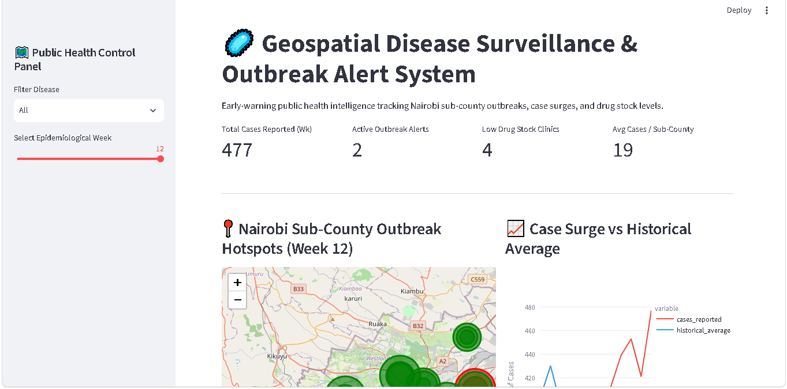
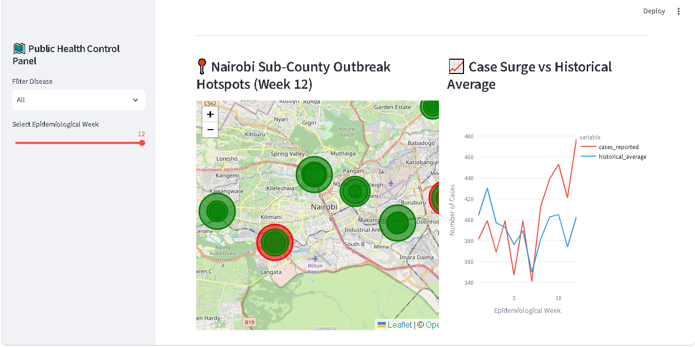
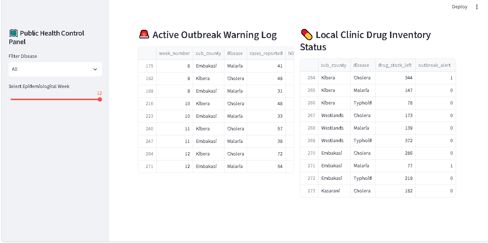

# 🦠 Geospatial Disease Surveillance & Outbreak Alert Dashboard

A proactive early-warning intelligence platform designed for Public Health Officers, Epidemiologists, and Hospital Administrators to detect disease outbreaks, visualize spatial transmission, and optimize supply chain resupply before clinical capacity is overwhelmed.

---

## 📊 Dashboard Preview

### 1. Geospatial Hotspot Map & Overview


### 2. Case Surge vs. Historical Trends


### 3. Supply Chain & Inventory Alert Panel


> **Live Interactive Demo:** [Launch Dashboard](https://disease-surveillance-dashboard-8.streamlit.app/)

---

## 🎯 The Problem & Business Impact

In public health management, delayed detection of infectious disease surges leads to severe clinical overloads, preventable mortality, and acute resource depletion. Traditional reporting relies on manual, cross-sectional spreadsheets, introducing three critical bottlenecks:

1. **Delayed Outbreak Detection:** Static Excel logs obscure exponential infection surges until emergency rooms and inpatient wards reach full capacity.
2. **Supply Chain Disruption:** Rapid spikes in diseases like Cholera, Typhoid, or Malaria trigger sudden demand for essential medical supplies (e.g., oral rehydration salts, IV fluids, targeted antibiotics), leading to stock-outs at local clinics before central facilities can respond.
3. **Spatial Blind Spots:** Without dynamic geospatial mapping, health authorities cannot trace localized transmission vectors or anticipate vector drift into neighboring, unprepared sub-counties.

---

## 💡 The Solution

This platform transforms passive epidemiological reporting into a real-time early-warning system. By uniting localized SQLite database queries, statistical anomaly thresholds, dynamic Folium GIS mapping, and inventory monitoring, the dashboard enables healthcare networks to pivot from reactive management to predictive intervention.

---

## 🚀 Key Features

### 1. Automated Statistical Anomaly Alerts
* Calculates historical baselines across sub-counties and triggers automated **Red Alert Indicators** on the dashboard when weekly reported cases exceed the historical moving average by **50% or more ($+0.5\sigma$)**.
* Directs hospital management to immediately mobilize surge beds, triage protocols, and clinical staffing.

### 2. Interactive Spatial GIS Heatmapping
* Renders interactive Folium maps overlaying administrative sub-counties using color-coded density markers (green-to-red severity scale).
* Enables granular filtering by specific pathogens (e.g., Cholera, Typhoid, Malaria) and epidemiological week to isolate localized transmission corridors.

### 3. Integrated Supply Chain & Inventory Intelligence
* Cross-references active outbreak locations directly with clinic inventory databases (`Drug_Stock_Left`).
* Computes real-time depletion rate warnings (e.g., *"Outbreak Alert: Current IV fluid inventory in Kibera projected to deplete within 72 hours. Immediate resupply dispatched."*).

### 4. Vector & Suspected Source Attribution
* Synthesizes environmental and clinical records to flag likely contamination vectors, supporting immediate targeted public health interventions (e.g., *"80% of active Cholera cases linked to municipal water distribution points. Water sampling protocol initiated."*).

---

## 🛠️ Technical Architecture & Stack

* **Data Engineering & Simulation:** Python (`pandas`, `numpy`) generating a 12-week longitudinal epidemiological and supply dataset across urban sub-counties.
* **Database Engine:** `SQLite` (`surveillance.db`) providing relational queries between weekly disease incidence logs and clinic inventory tables.
* **Geospatial & Analytics Interface:** `Streamlit`, `folium` (`streamlit-folium`), and `plotly` providing high-performance interactive UI rendering.

```text
disease-surveillance-dashboard/
│
├── app.py                      # Core Streamlit dashboard application
├── generate_outbreak.py        # Python data generator & SQLite population pipeline
├── requirements.txt            # Python dependencies
├── README.md                   # Technical documentation
│
├── data/
│   └── surveillance.db         # SQLite relational database (Case logs & Inventory)
│
├── screenshots/
│   ├── dashboard1.png
│   ├── dashboard2.png
│   └── dashboard3.png   # Dashboard UI preview screenshot


## ⚙️ Installation & Local Setup

To run this dashboard locally on your machine:

1. **Clone the repository:**

```bash
git clone https://github.com/PageG80/disease-surveillance-dashboard.git
cd disease-surveillance-dashboard
```

Initialize the SQLite Database & Generate Data:

```bash
python generate_outbreak.py
```

Launch the Streamlit Dashboard:

```bash
streamlit run app.py
```